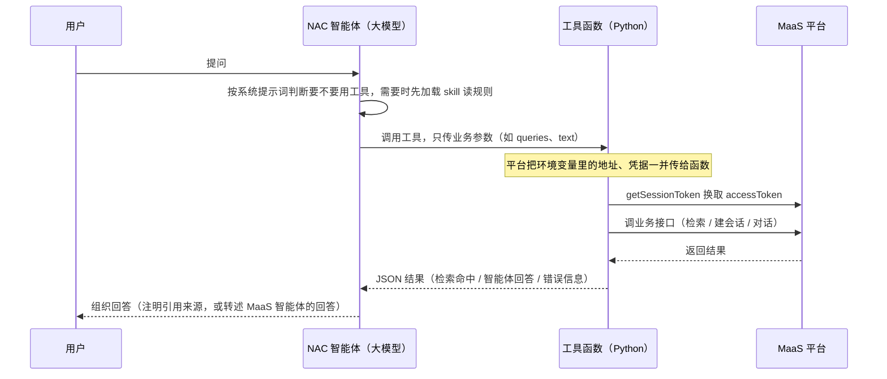

# 教程：对接 MaaS 平台 — 检索向量知识库 + 调用平台智能体

> 🟡 **Level 2 · 进阶** ｜ ⏱ 约 1 小时 ｜ 🔑 不依赖 MCP，用智能体自己的工具直接调 MaaS 的 HTTP 接口
>
> 本目录提供一套**可直接部署**的示例智能体：既能**检索 MaaS 平台上已有的向量知识库**，也能**调用 MaaS 平台上已有的智能体**进行多轮对话。鉴权、重试、批检索、流式聚合、日志脱敏均已实现。本教程不讲"从零实现"，讲的是：代码写完后**怎么接入智能体运行流程**、**环境变量 / skill / 系统提示词各写什么**、**哪些位置必须改**。
>
> 💡 适合的读者：
> - 已有 MaaS 平台账号（能拿到应用凭据）和一组业务相关的向量知识库，或一批已发布的 MaaS 智能体
> - 希望 NAC 里的智能体直接复用这些既有资产，**不重建索引、不改动 MaaS**
> - 需要弄清楚"环境变量放哪、skill 写什么、为什么部署后配置不生效"

## 目录

- [场景与目标](#场景与目标)
- [整体思路](#整体思路)
- [项目结构](#项目结构)
- [必需的改动](#必需的改动)
  - [替换精选 KB 映射表](#替换精选-kb-映射表)
  - [配置环境变量](#配置环境变量)
  - [配置要调用的 MaaS 智能体](#配置要调用的-maas-智能体)
  - [只用其中一类能力时](#只用其中一类能力时)
- [集成逻辑：代码写完后怎么接入智能体](#集成逻辑代码写完后怎么接入智能体)
- [环境变量、skill、系统提示词里分别写什么](#环境变量skill系统提示词里分别写什么)
- [案例：用 curl 直接调用 MaaS 智能体](#案例用-curl-直接调用-maas-智能体)
- [可选的微调](#可选的微调)
- [已封装的内置机制](#已封装的内置机制)
- [从旧版（MAP 命名）迁移](#从旧版map-命名迁移)
- [常见问题](#常见问题)

---

## 场景与目标

并非每个用户都需要从零搭建 RAG 或重写业务智能体。企业 / 政企客户常见的情况是：

- 已有一套 MaaS 平台，上面维护着数十甚至数百个向量知识库（切片与嵌入均已完成）
- 平台上还有一批已经调好、发布好的智能体
- 业务方希望 NAC 里的智能体**直接复用**这些资产，**不重建索引**、**不改动 MaaS**

本目录的方案：把 MaaS 的 HTTP 接口封装成智能体工具。你只需要：

1. 把系统提示词里的精选 KB 列表换成你自己平台上的 KB
2. 在 NAC 环境里配好 MaaS 地址、凭据、要调用的智能体
3. （可选）按业务微调同义词表、工具暴露范围

其余部分开箱即用。

---

## 整体思路

智能体（大模型）本身不直接发 HTTP 请求。它看到的是一组**工具**，由它决定何时调用哪个工具、传什么业务参数；真正去调 MaaS 接口的是工具背后的 Python 函数。MaaS 的地址、凭据**不写进智能体包**，而是在 NAC 环境里配成**环境变量**，部署时由平台注入给工具函数，大模型全程看不到。

示例智能体有两类能力：

| 能力 | 工具 | 调用的 MaaS 接口 |
|---|---|---|
| 检索 MaaS 向量知识库 | `maas_vec_batch_search`（混合检索，默认用它）<br>`maas_vec_semantic_search`（纯语义）<br>`maas_vec_fulltext_search`（全文）<br>`maas_vec_get_chunks_by_file`（取同一文件更多片段） | `/interface/api/kb/retriever_search_docs`<br>`/interface/api/kb/search_docs`<br>`/interface/api/kb/full_search_docs` |
| 调用 MaaS 平台智能体 | `maas_agent_create_session`（建会话）<br>`maas_agent_chat`（对话）<br>`maas_agent_delete_session`（删会话） | `/interface/api/ai/create_session`<br>`/interface/api/ai/chat`<br>`/interface/api/chatConversation/delete` |

所有工具调用前都先用 `/platform/api/v2/auth/getSessionToken` 换取 accessToken，这一步由工具代码自动完成并缓存。



---

## 项目结构

```
MaaS 平台对接/maas_kb_agent/
├── nexau.json                          ← Agent 注册表（含打包排除项）
├── agent.yaml                          ← 骨架：模型 + 工具 + skill + 中间件
├── systemprompt.md                     ← 指挥官：角色 + KB 映射表 + 检索流程 + 智能体调用规则
├── custom_tools/
│   ├── __init__.py
│   ├── _maas_client.py                 ← 检索用 HTTP client（鉴权 + 重试）；智能体工具共用它的 token 管理，不能删
│   ├── maas_api.py                     ← 4 个 maas_vec_* 工具的 Python 实现
│   ├── _maas_agent_client.py           ← 智能体用 HTTP client（会话 / 流式 / 脱敏）
│   └── maas_agent_api.py               ← 3 个 maas_agent_* 工具的 Python 实现
├── skills/
│   └── maas-agent-chat/SKILL.md        ← 调用 MaaS 智能体的规则，按需加载
└── tools/
    ├── read_file.tool.yaml             ← 三个标配工具
    ├── search_file_content.tool.yaml
    ├── run_shell_command.tool.yaml
    ├── maas_vec_*.tool.yaml            ← 4 个检索工具声明
    └── maas_agent_*.tool.yaml          ← 3 个智能体工具声明
```

| 层 | 位置 | 职责 | 是否需要修改？ |
|---|---|---|---|
| 鉴权 / 重试 / 流式层 | `_maas_client.py`、`_maas_agent_client.py` | token 缓存、single-flight、重试、SSE 聚合、日志脱敏 | ❌ 否 |
| 业务 / 加工层 | `maas_api.py`、`maas_agent_api.py`、`tools/*.tool.yaml` | 把每个 MaaS 接口封装成对 LLM 友好的函数与参数声明 | ❌ 否 |
| 规则层 | `skills/maas-agent-chat/SKILL.md` | 先建会话再对话、会话复用等调用规则 | ❌ 一般不用 |
| 编排层 | `agent.yaml`、`systemprompt.md` | 注册工具、KB 映射表、检索流程 | ✅ **需要修改** |
| 配置层 | NAC 环境变量 | 地址、凭据、智能体清单 | ✅ **需要配置** |

---

## 必需的改动

### 替换精选 KB 映射表

`systemprompt.md` 中有一段"精选 KB 映射表"，列出了示例用的 35 个法律法规库。**必须替换为你自己平台上的 KB**。

```markdown
# 精选 KB 映射表（可搜的全部库）

KB id                                | 名字（主题）
=====================================|=====================================
3b6efa50137911f0b7dbbc24111a57ca     | 知识管理产品_法律法规库
33fdab720eec11f08b85bc24111a57ca     | 统计制度
... (35 条)
```

> ✏️ **替换为你自己的 KB id + 主题名**。强烈建议：
> - **人工筛选**，只保留业务确实需要、内容质量达标的 KB（10–50 个量级即可）
> - 名称写"用户可理解的主题"，不要直接用平台原始库名（常带 `-pg / -es / -v2` 等内部后缀，对选库无帮助甚至误导）

紧随其后的"主题大类速查"与"选库流程"也按你的领域调整，把"用户可能查询的关键词"映射到"应检索哪几个库"，这决定了选库准确率的上限。

为什么直接写进 prompt，而不是提供一个"按主题搜 KB"的工具？

- 每次会话都要先 list / search 一次才能进入检索阶段 → **额外开销**
- 平台上库名相似度高（"政策库 / 政策库 2 / 政策库-pg"），关键词搜索难以区分哪个可用 → **易选错**
- 平台上成百上千个库里真正可供 Agent 使用的通常只有几十个 → **大量无效检索**

**通用原则**：能在编辑期枚举的内容，不要让 Agent 在运行时去发现。**Prompt 是成本最低的索引**。

### 配置环境变量

`agent.yaml` 里每个 MaaS 工具都通过 `extra_kwargs` 引用环境变量，部署时由平台替换为环境里的真实值：

```yaml
- name: maas_vec_batch_search
  yaml_path: tools/maas_vec_batch_search.tool.yaml
  binding: custom_tools.maas_api:maas_vec_batch_search
  extra_kwargs:
    host: "${env.MAAS_HOST}"
    app_key: "${env.MAAS_APP_KEY}"
    app_secret: "${env.MAAS_APP_SECRET}"
    user_id: "${env.MAAS_USER_ID}"
```

完整变量清单（「检索」指 4 个 `maas_vec_*` 工具，「智能体」指 3 个 `maas_agent_*` 工具）：

| 变量 | 含义 | 示例 | 谁需要 | 密文 |
|---|---|---|---|---|
| `MAAS_HOST` | MaaS 服务根地址，必须带 `http://` 或 `https://`。**没有缺省值**：未配置时工具直接返回配置错误，不发任何网络请求 | `http://<MaaS 地址>:<端口>` | 全部，**必填** | 否 |
| `MAAS_APP_KEY` | 换取 accessToken 的应用标识 | `<app_key>` | 全部，必填 | 建议 |
| `MAAS_APP_SECRET` | 应用密钥 | `<app_secret>` | 全部，必填 | 是 |
| `MAAS_USER_ID` | 以哪个 MaaS 用户的身份调用 | `<user_id>` | 全部，必填 | 否 |
| `MAAS_AGENT_NAMES` | 可调用的 MaaS 智能体别名，英文逗号分隔；别名自己起，规则见下一节 | `report,policy` | 智能体，必填 | 否 |
| `MAAS_PROJECT_IDS` | 每个别名对应的 MaaS 项目 ID | `<项目ID>,<项目ID>` | 智能体，必填 | 否 |
| `MAAS_APPLICATION_IDS` | 每个别名对应的 MaaS 智能体（应用）ID | `<应用ID1>,<应用ID2>` | 智能体，必填 | 否 |
| `MAAS_AGENT_SECRET_KEYS` | 每个别名对应的智能体密钥 | `<密钥1>,<密钥2>` | 智能体，必填 | 是 |
| `MAAS_DEFAULT_AGENT` | 默认别名，必须在别名列表里 | `report` | 智能体，必填 | 否 |
| `MAAS_VECTOR_KB_ID` | 默认知识库 ID。只在 `maas_vec_semantic_search` / `maas_vec_fulltext_search` / `maas_vec_get_chunks_by_file` 没传知识库 ID 时兜底；默认使用的 `maas_vec_batch_search` 不读它。想让智能体检索哪个库，把库 ID 写进系统提示词的 KB 表 | `<32 位知识库 ID>` | 检索，可选 | 否 |
| `MAAS_VERIFY_SSL` | HTTPS 证书校验开关，**缺省校验**，检索与智能体工具语义一致。取 `0 / false / no / off`（不区分大小写）才关闭；只对 https 地址生效。`MAAS_HOST` 是 https 且证书不是公开 CA 签发时需设 `false`，用 http 地址不用配 | `false` | 全部，可选 | 否 |
| `MAAS_SSE_IDLE_TIMEOUT` | 智能体流式输出中途无数据的最长等待秒数（缺省 30，最大 120） | `120` | 智能体，可选 | 否 |
| `MAAS_REQUEST_TIMEOUT` | 智能体非流式请求整体超时秒数（缺省 60；可配到 300，但单次请求总时限固定 120 秒，超过 120 不再生效） | `120` | 智能体，可选 | 否 |
| `LLM_MODEL` / `LLM_BASE_URL` / `LLM_API_KEY` | 模型配置 | — | 由平台按项目的大模型配置**自动注入，不要自己配** | — |

这些值从哪里来：

- **MaaS 地址、app_key、app_secret、user_id**：MaaS 开放平台的应用凭据和调用身份，向 MaaS 平台管理员获取。凭据必须和 `MAAS_HOST` 指向的是同一套 MaaS。
- **项目 ID、应用 ID**：要调用的智能体在 MaaS 上所属的项目 ID 和它自己的应用 ID。
- **智能体密钥**：在 MaaS 上给该智能体开通密钥后得到。没开通时智能体工具返回 `ok=false`，`error.message` 里带 MaaS 原文「该智能体未开通密钥」（代码不单独处理该错误）。

**凭据只放在环境配置里**，不要写进包里的任何文件，也不要写进 `agent.yaml`、`tool.yaml`、`systemprompt.md`。

### 配置要调用的 MaaS 智能体

`MAAS_AGENT_NAMES`、`MAAS_PROJECT_IDS`、`MAAS_APPLICATION_IDS`、`MAAS_AGENT_SECRET_KEYS` 四个变量**按位置一一对应**，条数必须相同：第 1 个别名用第 1 个项目 ID、第 1 个应用 ID、第 1 个密钥，以此类推。只调一个智能体时四个变量各写一项。

| 规则 | 说明 |
|---|---|
| 别名字符 | 只能用英文字母、数字和 `. _ -`，以字母或数字开头，不超过 64 个字符，不能用中文 |
| 分隔与空项 | 英文逗号分隔，不能有空项（末尾不要多一个逗号）；别名不能重复；最多 64 个 |
| 默认别名 | `MAAS_DEFAULT_AGENT` 必须在 `MAAS_AGENT_NAMES` 里；用户没点名时用它 |
| 点名不存在的别名 | 用户点名的别名不在配置里时，工具直接返回 `agent_alias is not configured`，**不会**改用默认智能体 |

四组列表条数不一致、默认别名不在列表里、任一必填项为空，工具都返回 `configuration_error`。

### 只用其中一类能力时

`agent.yaml` 里引用的每一个 `${env.X}`（**包括写在注释里的**）都必须有值，否则智能体加载失败。所以只用一类能力时要把用不到的部分**删掉**，而不是留着。

| 你的需求 | 怎么改 | 还要配哪些变量 |
|---|---|---|
| 只要知识库检索 | 删掉 `agent.yaml` 里三个 `maas_agent_*` 工具和 `skills:` 一项，并改 `description`；同时删掉系统提示词角色段里「另外，你可以把问题转给…」那句；删掉系统提示词里「调用 MaaS 平台智能体」一节和工具速查表里的智能体部分（否则大模型会去调已不存在的工具） | `MAAS_HOST`、`MAAS_APP_KEY`、`MAAS_APP_SECRET`、`MAAS_USER_ID`；**不用**配另外五个智能体变量 |
| 只要调用智能体 | 删掉四个 `maas_vec_*` 工具及对应 tool.yaml；删掉系统提示词里的 KB 表、检索流程、搜索词规范等检索内容，并改写「角色」段和「基本原则」第 1、5 条（否则仍会要求先调不存在的检索工具） | 九个变量（四个通用 + 五个智能体）；`MAAS_VECTOR_KB_ID` 不用 |
| 两类都要 | 保持原样 | 按上面清单 |

---

## 集成逻辑：代码写完后怎么接入智能体

一个智能体包（制品）就是一个目录，打成 tar 包上传。把一段调用 MaaS 的代码接入智能体，按七步走：

### 第 1 步：写工具函数

工具就是一个 Python 函数，参数有两类：**大模型填的业务参数**（哪些参数大模型能看到，只由第 2 步 `tool.yaml` 的 `input_schema` 决定），和**平台注入的配置**（第 3 步 `agent.yaml` 里 `extra_kwargs` 按参数名传入，值来自环境变量，大模型看不到）。函数返回字符串，格式由工具自己约定：`maas_agent_*` 返回 `{"ok": ..., "data": ..., "error": ..., "warnings": [...]}`；`maas_vec_*` 成功时返回 `{"count": ..., "hits": [...]}`，失败时返回 `{"error": "..."}`（`maas_vec_batch_search` 的单条失败放在 `errors[]`；证书校验失败等传输层错误，其余三个检索工具会直接抛出 `URLError`）。只用 Python 标准库（urllib），无需装第三方包。

```python
def maas_agent_chat(
    conversation_id: str,          # ↓ 大模型可见的业务参数，与 tool.yaml 的 input_schema 一一对应
    text: str,
    agent_alias: str,
    stream: bool = True,
    # ……其余可选业务参数省略
    *,                             # ↓ 平台注入的配置：来自 agent.yaml 的 extra_kwargs，大模型看不到
    host: str,
    app_key: str,
    app_secret: str,
    user_id: str,
    agent_names: str,
    project_ids: str,
    application_ids: str,
    agent_secret_keys: str,
    default_agent: str,
    **_,
) -> str:
    # 换 token → 调 /interface/api/ai/chat → 返回 JSON 字符串
    ...
```

### 第 2 步：写工具声明（`*.tool.yaml`）

声明里只写大模型要填的业务参数；`description` 是大模型决定用不用这个工具的唯一依据，要写清楚什么时候用。地址、凭据**不要**出现在 `input_schema` 里。`input_schema` 末尾写 `additionalProperties: false`，防止大模型传入与注入配置同名的参数（如 `host`）把地址或凭据覆盖掉；如果工具调用报 `Additional properties are not allowed`，说明运行时版本较旧，删掉这一行即可。

```yaml
type: tool
name: maas_agent_create_session
description: Create a MaaS agent conversation using a runtime-managed agent profile.
input_schema:
  type: object
  properties:
    session_name:
      type: string
      description: Human-readable name for the new conversation.
    agent_alias:
      type: string
      description: Optional configured agent alias; runtime default is used when omitted.
  required:
    - session_name
  additionalProperties: false
```

### 第 3 步：在 `agent.yaml` 里登记工具

```yaml
tools:
  - name: maas_agent_chat
    yaml_path: tools/maas_agent_chat.tool.yaml
    binding: custom_tools.maas_agent_api:maas_agent_chat
    extra_kwargs:                       # 部署时会被替换成同名环境变量的值
      host: "${env.MAAS_HOST}"
      app_key: "${env.MAAS_APP_KEY}"
      app_secret: "${env.MAAS_APP_SECRET}"
      user_id: "${env.MAAS_USER_ID}"
      agent_names: "${env.MAAS_AGENT_NAMES}"
      project_ids: "${env.MAAS_PROJECT_IDS}"
      application_ids: "${env.MAAS_APPLICATION_IDS}"
      agent_secret_keys: "${env.MAAS_AGENT_SECRET_KEYS}"
      default_agent: "${env.MAAS_DEFAULT_AGENT}"
  # maas_agent_create_session 写法相同；maas_agent_delete_session 只要前四项
  - name: maas_vec_batch_search         # 知识库检索工具只要前四项
    yaml_path: tools/maas_vec_batch_search.tool.yaml
    binding: custom_tools.maas_api:maas_vec_batch_search
    extra_kwargs:
      host: "${env.MAAS_HOST}"
      app_key: "${env.MAAS_APP_KEY}"
      app_secret: "${env.MAAS_APP_SECRET}"
      user_id: "${env.MAAS_USER_ID}"

skills:
  - skills/maas-agent-chat
```

- `yaml_path` 与 `skills` 下的路径：相对 `agent.yaml` 所在目录。`agent.yaml` 不在包根目录（比如放在 `agents/` 下）时，前面要加 `../`。
- `binding`：始终从包根目录算起的 Python 模块路径，加冒号和函数名，与 `agent.yaml` 放哪无关；`custom_tools/` 和 `skills/` 放在包根目录。
- `extra_kwargs`：按参数名传给函数，值用 `"${env.变量名}"` 引用环境变量。**值一律加双引号**：替换发生在解析 YAML 之前，不加引号时纯数字的 ID 会被当成数字，工具报配置错误。
- 写在注释里的 `${env.X}` 同样会被替换，没配就加载失败，所以注释里不要写这个形式。

### 第 4 步：写 skill（推荐）

调用规则（先建会话再对话、会话怎么复用、出错怎么处理）放在 `skills/maas-agent-chat/SKILL.md`，智能体需要时才加载，不占平时的上下文。

- 文件开头的 `name` 和 `description` 一直对大模型可见，`description` 要写清楚"什么情况下该用这个 skill"。
- 在 `agent.yaml` 的 `skills` 列表里登记目录后，平台会自动给智能体一个 `LoadSkill` 工具，**不要**手动写进 `tools`。

### 第 5 步：在系统提示词里写入口

写清楚：什么时候检索知识库、什么时候调用 MaaS 智能体、第一次调用前先加载 skill、结果怎么转述给用户。挂了 skill 的智能体，系统提示词里要有这句原话（平台规范检查按原句匹配，不要改写）：「部署后 skills 根目录位于 `/home/user/.skills/`」。

### 第 6 步：打包上传

```bash
tar -cf maas_kb_agent.tar --exclude=__pycache__ --exclude='*.pyc' \
  --exclude=runtime.env --exclude=sandbox.env --exclude=.env -C maas_kb_agent .
```

包里不能有符号链接，大小不超过 100 MB，也不要带凭据文件。示例的 `nexau.json` 已把 `runtime.env`、`sandbox.env` 列入 `excluded`，用平台工具打包时同样会排除。在控制台上传这个 tar 包；或进入 `maas_kb_agent/` 目录执行 `nac deploy <环境名> --base-url <你的 NAC 地址> --project-id <项目ID>`（需先用个人令牌登录；这条命令自己打包当前目录，不用上面的 tar；受保护的环境如 production 请在控制台上传部署）。

### 第 7 步：配环境变量、部署、验证

1. 在项目的环境配置里添加**运行时（Runtime）环境变量，不是试验场的沙箱环境**（清单见[配置环境变量](#配置环境变量)），密钥类设为密文。**建议配在项目级**，对项目下所有环境都生效；某个环境要用不同的值时，再在该环境里配同名变量覆盖。试验场里测试用的草稿环境会过期，不要只配在它上面。用接口或命令行保存时是**整组替换**，要带上已有的全部变量。
2. 部署（或重新部署）。**环境变量在部署时生效**，改了变量要重新部署。如果改的是包里的文件，要重新上传成**新版本**再部署（试验场里重新发起测试）；只对旧版本点"重新部署"，旧包里的文件仍然生效。
3. 在试验场发一句话验证，例如「请调用 MaaS 平台上的智能体，问它：请用一句话介绍你自己」，看工具调用是否返回 `ok=true`、回答是否是 MaaS 智能体的原话；检索则问一个 KB 表内的主题，看是否带来源引用。

---

## 环境变量、skill、系统提示词里分别写什么

| 位置 | 写什么 | 不要写什么 |
|---|---|---|
| 环境变量（NAC 环境配置） | MaaS 地址、应用凭据、调用身份、要调用的智能体（别名、项目 ID、应用 ID、密钥）、默认知识库 ID | — |
| 包里的 `runtime.env` / `.env` 文件 | 不建议使用 | 任何凭据。`runtime.env`（任何目录下）会随包上传，部署时**覆盖**项目和环境配置里的同名变量，而且这些值**不会显示在环境变量页面里**；`.env` 只在本地调试时生效。在控制台在线编辑项目时，编辑器的「环境变量」面板写的就是 `runtime.env`：凭据不要填在那里，编辑器提示"缺少环境变量"时，到项目设置的环境变量里配即可 |
| `agent.yaml` | 工具登记，用 `"${env.X}"` 引用环境变量 | 任何真实的地址、凭据、ID |
| skill（`SKILL.md`） | 调用顺序和规则：先建会话再对话；同一件事复用同一个会话；不编造会话 ID 和别名；只在用户明确要求时删除会话；按 `ok / error` 如实转述结果 | 凭据、地址、别名清单 |
| 系统提示词 | 何时检索知识库、何时调用 MaaS 智能体、先加载 skill、回答格式（注明引用来源）、KB 映射表 | 凭据、地址；也不要让大模型向用户索要凭据 |

> ⚠️ 如果你的工具代码来自别人的包，先检查包里有没有 `runtime.env`（任何目录下都算），有就删掉：它会随包上传并覆盖环境配置里的同名变量，改了环境配置也不生效；它里面的值也不出现在环境变量页面里，排查时极易误以为没配。

---

## 案例：用 curl 直接调用 MaaS 智能体

不经过智能体、直接用 curl 也能走通，适合先验证凭据和网络。

| 步骤 | 接口 | 要点 |
|---|---|---|
| ① 换 token | `POST /platform/api/v2/auth/getSessionToken` | 请求体 `app_key`、`app_secret`、`user_id`；返回 `data.access_token`，有效期约 2 小时，可缓存复用 |
| ② 建会话 | `POST /interface/api/ai/create_session` | 请求头 `accessToken`、`userId`；请求体 `application_id`、`session_name`；返回体里的 `data.data` 就是会话 ID |
| ③ 对话 | `POST /interface/api/ai/chat` | 请求头再加 `X-Secret-Key: <智能体密钥>`；请求体 `project_id`、`application_id`、`conversation_id`、`text`、`stream`、`using_context`。非流式回答在 `data.answer`，引用在 `data.docs` |
| ④ 删会话（可选） | `POST /interface/api/chatConversation/delete` | 请求体 `{"id": "<会话ID>"}` |

```bash
# 0. 准备
export MAAS_HOST=http://<MaaS 地址>:<端口>
export MAAS_APP_KEY=<app_key> MAAS_APP_SECRET=<app_secret> MAAS_USER_ID=<user_id>
export PROJECT_ID=<项目ID> APP_ID=<智能体应用ID> AGENT_SK=<智能体密钥>
# MAAS_HOST 是 HTTPS 且证书不是公开 CA 签发时，下面每条 curl 加 -k

# 1. 换 accessToken
TOKEN=$(curl -s -X POST "$MAAS_HOST/platform/api/v2/auth/getSessionToken" \
  -H 'Content-Type: application/json' \
  -d "{\"app_key\":\"$MAAS_APP_KEY\",\"app_secret\":\"$MAAS_APP_SECRET\",\"user_id\":\"$MAAS_USER_ID\"}" \
  | jq -r .data.access_token)

# 2. 建会话：返回体里的 data.data 就是会话 ID
CID=$(curl -s -X POST "$MAAS_HOST/interface/api/ai/create_session" \
  -H "accessToken: $TOKEN" -H "userId: $MAAS_USER_ID" -H 'Content-Type: application/json' \
  -d "{\"application_id\":\"$APP_ID\",\"session_name\":\"测试会话\"}" \
  | jq -r .data.data)

# 3. 对话（非流式）
curl -s -X POST "$MAAS_HOST/interface/api/ai/chat" \
  -H "accessToken: $TOKEN" -H "userId: $MAAS_USER_ID" -H "X-Secret-Key: $AGENT_SK" \
  -H 'Content-Type: application/json' \
  -d "{\"project_id\":\"$PROJECT_ID\",\"application_id\":\"$APP_ID\",\"conversation_id\":\"$CID\",\"text\":\"你好，请用一句话介绍你自己。\",\"stream\":false,\"using_context\":true}" \
  | jq '{answer: .data.answer, docs: .data.docs}'

# 4. 删除会话（可选）
curl -s -X POST "$MAAS_HOST/interface/api/chatConversation/delete" \
  -H "accessToken: $TOKEN" -H "userId: $MAAS_USER_ID" -H 'Content-Type: application/json' \
  -d "{\"id\":\"$CID\"}"
```

**流式对话**：请求体改成 `"stream": true` 并加 `"version": 2`，返回 SSE 流。每行形如 `data: {"code":200, "data":{"type":"think 或 answer", "answer":"一段文字"}}`：`type=think` 是思考过程，`type=answer` 的片段拼起来就是回答；带 `exec_elapsed_secs` 的那一条表示结束。`maas_agent_chat` 工具默认用流式，并在工具内部拼好完整回答再交给大模型。

### 在智能体里使用

把这个能力加进你自己的智能体：

1. 把本目录 `custom_tools/_maas_client.py`（智能体工具共用它的 token 管理；你的包里若已有同名旧文件，请覆盖）、`custom_tools/_maas_agent_client.py`、`custom_tools/maas_agent_api.py`、`tools/maas_agent_*.tool.yaml`、`skills/maas-agent-chat/` 复制到你的包里对应位置。
2. 照本目录 `agent.yaml` 里"调用 MaaS 平台智能体"那一段，登记三个工具和 `skills`（`agent.yaml` 不在包根目录时，`yaml_path` 与 `skills` 路径前加 `../`）。
3. 把 `systemprompt.md` 里「调用 MaaS 平台智能体」一节并入你的系统提示词（含「部署后 skills 根目录位于 `/home/user/.skills/`」那句）；你的智能体没有检索工具的话，删掉其中提到 `maas_vec_*` 的那句。
4. 配好环境变量，打包上传、部署。

实际对话效果：

| 用户 | 请调用 MaaS 平台上的智能体，让它用一句话介绍一下它自己，然后把它的回答原样告诉我。 |
|---|---|
| 智能体内部 | 加载 skill `maas-agent-chat` → `maas_agent_create_session`（未指定别名，用默认智能体）→ `maas_agent_chat` 返回 `ok=true` |
| 智能体回答 | 已调用 MaaS 平台智能体，它的回答原文如下：…… |

同一件事的后续消息会复用同一个会话（MaaS 智能体能记住上下文）。

---

## 可选的微调

### 按业务领域调整同义词表

`systemprompt.md` 的"铁律 2 — 同义词扩召回"中有一张对照表：

```markdown
| 用户查询词 | 建议同时尝试的相关词 |
|---|---|
| 政务      | 政府、公共事务、行政 |
| 外商投资  | 外资、对外开放、涉外投资 |
| 党建      | 党的建设、党组织、党务 |
| 保密      | 信息安全、机密、涉密 |
```

> ✏️ **按你自己的业务术语替换这张表**。作用是引导 LLM：用户查"政务"时不要只搜"政务"，同时检索"政府 / 行政"——入库语料与查询用词之间常存在偏差。

向量检索的命中质量主要由 query 质量决定。在 Prompt 里专门用一节指导 Agent 构造 query，效果优于调整任何工具参数。"铁律 1 — 关键词只保留核心名词"为通用规则，保留即可：

```markdown
- ✅ 1-3 个汉字 / 1 个名词短语
- ❌ 不应包含疑问词（"是什么"/"如何"/"为何"）、连词、句号问号
- ❌ 不应将整句作为 query
```

### 隐藏不想暴露的检索工具

默认 `agent.yaml` 暴露 4 个检索工具：

- `maas_vec_batch_search` —— 主力，cross-product 批检索
- `maas_vec_semantic_search` —— 备用：纯语义
- `maas_vec_fulltext_search` —— 备用：BM25
- `maas_vec_get_chunks_by_file` —— 取同源文档其他切片

**经验值**：Agent 可见的工具越多，"选错工具"的概率越大。不希望 Agent 调用某个工具时，把 `agent.yaml` 里对应段落**注释掉**即可：

```yaml
tools:
  - name: maas_vec_batch_search
    yaml_path: tools/maas_vec_batch_search.tool.yaml
    binding: custom_tools.maas_api:maas_vec_batch_search
    extra_kwargs: { ... }

  # # batch_search 已能覆盖大部分场景，下面两个备用默认可隐藏。
  # - name: maas_vec_semantic_search
  #   yaml_path: tools/maas_vec_semantic_search.tool.yaml
  #   binding: custom_tools.maas_api:maas_vec_semantic_search
  #   extra_kwargs: { ... }
```

采用注释而非删除，是为了将来可直接取消注释。注释块里不要写 `${env.…}` 形式的引用（见第 3 步）。

> ⚠️ **不要注释 `maas_vec_batch_search`**——它是主力工具，且兼容单查询（`queries=["x"]`, `knowledge_base_ids=["y"]`）。

**通用原则**：当工具同时存在"易用但低效"与"稍复杂但高效"两种调用方式时，**隐藏低效的那一个**。

### 检索调优参数

`systemprompt.md` 的"调优参数"一节给出了 `top_k / score_threshold / weights` 的默认值，一般场景使用默认即可：

| 参数 | 默认 | 何时调整 |
|---|---|---|
| `top_k` | 5 | KB 内容稀疏、希望多返回几条 → 调至 10-20 |
| `score_threshold` | 0 | 噪声较多、需过滤低相关结果 → 调至 0.4-0.6 |
| `weights` | `[0.5, 0.5]` | 业务更看重精确关键词 → 偏 BM25 `[0.7, 0.3]`；释义类问题偏向量 `[0.3, 0.7]` |

`agent.yaml` 顶级配置一般无需调整：

| 配置 | 取值 | 说明 |
|---|---|---|
| `temperature` | 0.2 | 法规 / 政策类回答需要精确引用，不宜调高 |
| `max_iterations` | 50 | 多轮搜索 + fallback + 取同源切片可能需要 10+ 轮 |
| `tool_call_mode` | structured | OpenAI 风格 function calling |
| `ContextCompactionMiddleware.threshold` | 0.6 | 上下文使用超过 60% 时自动压缩 |

---

## 已封装的内置机制

以下机制已在 `custom_tools/` 中实现，**无需写代码**。本节让你了解后台在发生什么（看到 fallback 标记、结果字段不完整时便于理解）。

### 检索部分（`_maas_client.py` + `maas_api.py`）

| 机制 | 行为 |
|---|---|
| 批检索 + 并发 | `maas_vec_batch_search` 接受 `queries[] × knowledge_base_ids[]`，对 cross-product 做并发检索，20 个 (query, kb) 组合在数秒内完成；单查询也通过它完成 |
| 结果裁剪 | 原始 hit 十余个字段中，只保留 `page_content / title / file_name / file_id / segment_position` 等有决策价值的字段，20 个 hit 可省数千 token（`score` 在不同 query 间量纲不一致，反而误导 LLM，所以不返回） |
| 服务端 bug 自动 fallback | 部分早期 KB 的 hybrid 端点会报 `'Document' object has no attribute 'id'` 或 `不支持全文检索`，工具识别后自动降级到 semantic 端点，降级的 hit 带 `fallback: true`，系统提示词要求 Agent 在回答里简短说明。回答偶尔出现"该结果为降级返回"属于正常行为 |
| Hybrid body 完整性 | `/retriever_search_docs` 若 body 简化（只传 `query` + `knowledge_base_id`），服务端不报错但静默退化为 semantic。工具显式携带 `retriever_type=hybrid` + 完整 `config`，确保 hybrid 真正生效 |
| token 计时 | 过期时刻**取自 token 自身的 JWT `exp`**，而非"本地时刻 + `expires_in`"。MaaS 在 token 未到期时会复用同一个 token 并从首次签发起计时；按 `now + expires_in` 重算会越差越远，表现为搜索 401 而且清缓存重取也没用。读不到 `exp` 时回落：服务端给回同一个 token 就沿用旧计时 |
| 鉴权失败重放 | `HTTP 401/403`、`state=28201`、`token无效` 时清除被拒的那一个 token、重取并重放一次；若重取拿回的仍是被拒的那个，改走 `/platform/api/v2/auth/refreshToken` 强制换发；换发不成不会把已知被拒的 token 写回缓存 |
| single-flight | 取 token 与换发同一 key 同一时刻只有一个线程真正发请求，其余等待并共享结果**与失败**，避免并发检索在 token 边界打出一堆认证请求 |
| transient 重试 | HTTP 5xx 或 `state=20001` 的临时错误最多退避重试两次 |
| 鉴权日志 | 关键事件打到 stdout（前缀 `[maas-auth]`，进 pod 日志）：走了哪条计时分支、`refreshToken` 试没试、结果如何，是判断鉴权问题出在哪一层的主要依据 |

### 智能体部分（`_maas_agent_client.py` + `maas_agent_api.py`）

| 机制 | 行为 |
|---|---|
| token 缓存 | 与检索工具共用同一套 token 管理（同一份进程级缓存）：已有的 token 直接复用，被拒后重取，若拿回的仍是被拒的那个，改走 `refreshToken` 换发 |
| 有限重试 | 网络类临时错误按有界策略重试（最多 3 次尝试），耗尽后返回带 `retryable` 标记的错误，不无限等待 |
| 流式聚合 | `maas_agent_chat` 默认走 SSE：解析 `think` / `answer` 片段，识别 `exec_elapsed_secs` 结束标记，在工具内拼好完整回答再返回；中途无数据超过 `MAAS_SSE_IDLE_TIMEOUT` 返回 `stream_interrupted` |
| 资源上限 | 响应体、SSE 事件数、回答字符数等都有硬上限，超限报错而不是撑爆内存 |
| 日志脱敏 | 密钥、令牌、四组列表等敏感值在日志和错误信息里统一替换成 `[REDACTED]` |
| 配置校验 | 启动调用前校验四组列表条数一致、别名合法、默认别名在列表里，不合格返回 `configuration_error`（带可读原因） |
| 别名绑定 | 会话与别名绑定；`agent_alias` 不在配置里直接报 `agent_alias is not configured`，不静默改用默认 |

---

## 从旧版（MAP 命名）迁移

本样例的前身叫"MAP 知识库问答"，只含检索。已按旧版部署的，对照下表改名；**检索的请求与返回行为不变**，只有下面三处行为变化。

| 旧版 | 新版 |
|---|---|
| 目录 `MAP 知识库问答/` | `MaaS 平台对接/` |
| 教程 `tutorial-map-vector-kb.md` | `tutorial-maas-platform.md` |
| 包目录 `MAP 知识库问答/MAP 知识库问答/` | `maas_kb_agent/` |
| 智能体名 `map_kb_agent`（`nexau.json` / `agent.yaml`） | `maas_kb_agent` |
| `systemprompt_vb.md` | `systemprompt.md` |
| `custom_tools/_map_client.py`（`MapClient`） | `custom_tools/_maas_client.py`（`MaasClient`） |
| `custom_tools/map_api.py` | `custom_tools/maas_api.py` |
| 工具 `map_vec_batch_search` / `map_vec_semantic_search` / `map_vec_fulltext_search` / `map_vec_get_chunks_by_file` | `maas_vec_*`（同名后缀） |
| 环境变量 `MAP_HOST` / `MAP_APP_KEY` / `MAP_APP_SECRET` / `MAP_USER_ID` / `MAP_VECTOR_KB_ID` / `MAP_VERIFY_SSL` | `MAAS_*`（同名后缀） |
| 日志前缀 `[map-auth]` | `[maas-auth]` |
| （无） | 新增 `maas_agent_*` 三个工具、`skills/maas-agent-chat`、五个智能体变量 |

**三处行为变化**：

1. **去掉了地址回落，`MAAS_HOST` 必填**。旧版没配地址时会把凭据发到代码里写死的一个公网演示地址；新版没有任何缺省地址，`host` 参数与 `MAAS_HOST` 都为空时直接返回配置错误，不发任何网络请求。`agent.yaml` 里每个检索工具要加一行 `host: "${env.MAAS_HOST}"`。
2. **证书校验缺省开启**。旧版检索工具缺省不校验证书，新版与智能体工具统一为缺省校验，只有 `MAAS_VERIFY_SSL` 取 `0 / false / no / off` 才关闭。原来依赖"缺省不校验"访问自签名 https 地址的，升级后要显式设 `MAAS_VERIFY_SSL=false`；否则检索工具会直接抛出 `URLError`（`CERTIFICATE_VERIFY_FAILED`），智能体工具返回 `transport_error`。
3. **新增智能体工具**。可选，不需要就按[只用其中一类能力时](#只用其中一类能力时)删掉。

---

## 常见问题

| 现象 | 原因 | 处理 |
|---|---|---|
| 部署后对话起不来，日志提示某个环境变量未定义 | `agent.yaml` 引用的 `${env.X}`（含注释里的）没在环境里配置 | 补上变量后重新部署；用不到的工具连同引用一并删掉 |
| 改了环境变量，行为没变 | 环境变量在部署时生效 | 重新部署 |
| 改了包里的文件，行为没变 | 对旧版本点"重新部署"，读的仍是旧包里的文件 | 上传成新版本再部署 |
| 配了环境变量，工具里却是空值或旧值 | 包里的 `runtime.env` 随包上传，覆盖了项目 / 环境配置里的同名变量，且不显示在环境变量页面 | 删掉包里（任何目录下）的 `runtime.env`，重新上传新版本再部署；打包时排除它 |
| 试验场里测试一阵后变量没了 | 试验场的草稿测试环境会过期 | 变量配在项目级；用接口保存时是整组替换，要带上已有的全部变量 |
| 部署失败，日志提示 `LLM_MODEL` 未设置 | 项目里还没有可用的大模型 | 先给项目配好模型，再重新部署 |
| `extra_kwargs` 里的 ID 工具报配置错误 | 值没加引号，纯数字 ID 被解析成数字 | 所有 `"${env.X}"` 加双引号 |
| 检索工具返回「Missing required runtime variable(s): …」 | `MAAS_HOST` 或鉴权三要素没配或为空，工具不发任何请求 | 补上变量，重新部署 |
| 对话返回「该智能体未开通密钥」（HTTP 422） | MaaS 上没给这个智能体开通密钥 | 在 MaaS 上开通，或从四组列表里删掉这个智能体 |
| 返回 `agent_alias is not configured` | 请求的别名不在 `MAAS_AGENT_NAMES` 里 | 检查别名拼写，或补充配置 |
| 智能体工具返回 `configuration_error`，如「MAAS_AGENT_NAMES is required」「MAAS_DEFAULT_AGENT is not configured」 | 任一必填变量为空；四组列表有空项、条数不一致、别名重复或不合法（如用了中文）；默认别名不在列表里；`MAAS_HOST` 没带 `http://` 或 `https://` | 先查包里有没有 `runtime.env`，再按[配置环境变量](#配置环境变量)逐项核对，重新部署 |
| 换 token 失败，提示密钥不匹配或应用未激活 | `app_key` / `app_secret` 和 `MAAS_HOST` 指向的不是同一套 MaaS | 核对凭据和地址 |
| 智能体工具返回 `transport_error`，消息里是 `URLError`；检索工具（`maas_vec_*`）则直接抛出 `URLError`（`maas_vec_batch_search` 把它放进 `errors[]`），也可能是 `CERTIFICATE_VERIFY_FAILED` 或 `unknown url type`（`MAAS_HOST` 没带协议头，仅智能体工具报 `configuration_error`） | https 证书不是公开 CA 签发（缺省会校验）、地址填错或网络不通，报错文字区分不出来 | 用[案例](#案例用-curl-直接调用-maas-智能体)里的 curl 分别跑不加 `-k` 和加 `-k`：只有加 `-k` 能通就是证书问题，设 `MAAS_VERIFY_SSL=false` 后重新部署；两次都不通，先核对 `MAAS_HOST`，再请运维放通网络 |
| 智能体工具返回 `stream_interrupted` 或 `outcome_unknown`，但 MaaS 那边其实出了回答 | MaaS 智能体输出中途停顿超过 30 秒，或非流式请求超过总时限（120 秒） | 调大 `MAAS_SSE_IDLE_TIMEOUT`（最大 120）；非流式请求总时限固定 120 秒，更慢的智能体请用流式（默认就是流式）。改后重新部署 |
| 检索偶尔带"降级返回"说明 | 命中了会触发服务端 hybrid bug 的旧 KB，工具自动降级到 semantic | 属正常机制；可在 KB 表里去掉持续降级的库 |
| 混合检索的排序里降级结果排在前面 | hybrid 的 score（BM25 + 向量加权）与降级后 semantic 的 score（纯余弦）量纲不同，工具按原始 score 排序且未做归一化 | 对排序公平性敏感时，在 `maas_api.py` 里自行加权重或把非降级结果排前；这已超出本教程范围 |
| 检索速度偏慢 | 瓶颈在上游 MaaS 的响应时间和网络往返，而非 Agent | 在系统提示词里压缩 query 数量（3 个同义词即可）；过滤持续降级的 KB；同会话重复问题可加会话级缓存。不必调大 runtime 资源 |
| 启动报 `ContextCompactionMiddleware` import 错误 | `agent.yaml` 里 middleware 的 import 路径要含 `execution` 一层 | 使用 `nexau.archs.main_sub.execution.middleware.context_compaction:ContextCompactionMiddleware`，参数名是 `threshold` 而非 `threshold_ratio` |

---

## 下一步

替换 KB 映射表、配好环境变量并部署后，到 NAC 试验场用真实问题验证：

- 问一个 KB 表内的主题 → 检查 Agent 是否选对了库、回答是否带来源
- 故意问表外主题 → 检查 Agent 是否如实告知"不在可用 KB 列表内"
- 问一个用词不一致的问题（如用"政务"查"行政"相关内容）→ 检查是否启用了同义词扩召回
- 让它调用 MaaS 智能体并追问一轮 → 检查是否复用了同一个会话
- 点一个不存在的别名 → 应看到 `agent_alias is not configured`，而不是悄悄改用默认

← 返回 [Cookbook 主页](../README.md) ｜ 相关阅读：[金融数据智能体（封装 REST API）](../金融数据智能体/tutorial-finance-agent.md) ｜ [劳动法问答（自建 SKILL）](../劳动法问答/tutorial-agentic-rag-agent.md)
